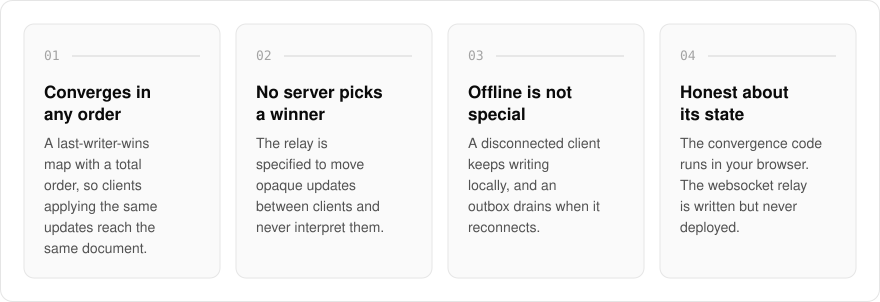
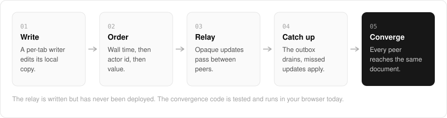

  <picture>
    <source media="(prefers-color-scheme: dark)" srcset=".github/assets/hero-dark.png">
    
  </picture>

<h1 align="center">fight.me.at</h1>

<strong>Concurrent edits that converge, with no server refereeing the merge.</strong>

  
  
  

  <a href="https://fight.me.at">Website</a> ·
  <a href="#features">Features</a> ·
  <a href="#how-it-works">How it works</a> ·
  <a href="#built-with">Built with</a>

Most realtime apps settle a conflict by letting a server decide whose edit won. fight.me.at is my published design for an unreleased, parked experiment that works the other way: concurrent edits from many clients converge on their own over a CRDT, and the relay only carries updates. It shows what is built and is honest about what was never finished. The convergence code is written, tested and runs entirely in your browser; the websocket relay that would carry updates between two browsers is written but has never been deployed. There is nothing to sign up for and nothing to buy.

  <picture>
    <source media="(prefers-color-scheme: dark)" srcset=".github/assets/overview-dark.svg">
    
  </picture>

## Why fight.me.at

| The usual realtime app | fight.me.at |
| --- | --- |
| A server decides whose edit won | A total order means every client reaches the same document on its own |
| Offline is an error state to recover from | Offline writes keep landing locally and drain from an outbox on reconnect |
| Presence mixed into the shared state | Presence rides the same rail but never has to converge |
| A lost relay brings every client back at once | Reconnection backs off on a schedule capped at thirty seconds |

## Features

- **Last-writer-wins map CRDT**: for every key, the winning write is decided by wall time, then actor id, then value. The comparison is a total order, so clients applying the same updates in any order reach the same document.
- **No server decides who won**: the relay is specified to move opaque updates between clients and never interpret them.
- **Offline is not a special case**: a disconnected client keeps writing locally, and an outbox drains on reconnect. Catching up means applying missed updates, not replaying a timeline.
- **Branches and saved versions**: edit a copy of a document without peers seeing it and merge it back, or save a version and restore it as a new edit every peer receives.
- **Presence kept apart from the document**: who is here and where they are travels on the same rail but never becomes state that has to converge.
- **Backed-off reconnection**: a dropped socket retries on an exponential schedule capped at thirty seconds, so a room that lost its relay does not come back as a stampede.
- **Postgres-backed partial replication**: a document can be read one page of registers at a time, pushed with the same merge ordering the client uses, and held open as a live read until a push moves it forward.
- **Anonymous by design**: each writer is a per-tab identity, and the app does not use accounts. A legacy server-authoritative match board survives as a contrast: the same product with a referee.

## How it works

  <picture>
    <source media="(prefers-color-scheme: dark)" srcset=".github/assets/flow-dark.svg">
    
  </picture>

Each tab writes to its own copy of the document. Every write carries a wall time and an actor id, and for any key the winner is chosen by wall time, then actor id, then value, so the order updates arrive in never changes the result. In the design, a relay passes those updates between peers without reading them, and a client that was offline drains its outbox and applies what it missed. That relay is written but not deployed, so today the convergence code runs only in your browser.

## Built with

  
  
  
  
  
  
  

- Next.js 16 (App Router), React 19, TypeScript
- Tailwind CSS 4
- An app-local CRDT (last-writer-wins map) with a WebSocket transport
- oRPC for the document replication procedures
- Postgres for the durable document replica

## Part of the me.at family

fight.me.at is one of my [`*.me.at`](https://me.at) apps. They share one design system, account, and app shell. Development happens in a private monorepo; this repository is the project's public-facing home.

## License

Source-available. See [LICENSE](LICENSE).
