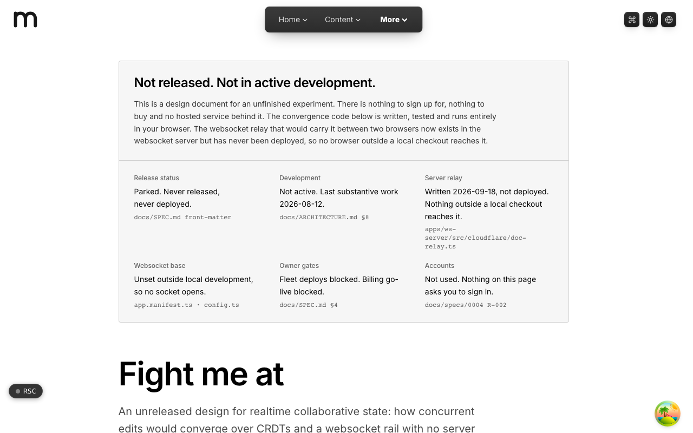

  <picture>
    <source media="(prefers-color-scheme: dark)" srcset=".github/assets/hero-dark.png">
    
  </picture>

# fight.me.at

An unreleased design for realtime collaborative state: concurrent edits that converge over CRDTs and a websocket rail, with no server refereeing the merge.

fight.me.at is a published design document for a parked experiment. It explains how concurrent edits from many clients would converge without a server deciding who won, shows what is built, and is honest about what was never finished. The convergence code is written, tested and runs entirely in your browser; the websocket relay that would carry updates between two browsers is written but has never been deployed. There is nothing to sign up for and nothing to buy.

**Live:** [fight.me.at](https://fight.me.at)

## Features

- **Last-writer-wins map CRDT**: for every key, the winning write is decided by wall time, then actor id, then value. The comparison is a total order, so clients applying the same updates in any order reach the same document.
- **No server decides who won**: the relay is specified to move opaque updates between clients and never interpret them.
- **Offline is not a special case**: a disconnected client keeps writing locally, and an outbox drains on reconnect. Catching up means applying missed updates, not replaying a timeline.
- **Branches and saved versions**: edit a copy of a document without peers seeing it and merge it back, or save a version and restore it as a new edit every peer receives.
- **Presence kept apart from the document**: who is here and where they are travels on the same rail but never becomes state that has to converge.
- **Backed-off reconnection**: a dropped socket retries on an exponential schedule capped at thirty seconds, so a room that lost its relay does not come back as a stampede.
- **Postgres-backed partial replication**: a document can be read one page of registers at a time, pushed with the same merge ordering the client uses, and held open as a live read until a push moves it forward.
- **Anonymous by design**: each writer is a per-tab identity, and the app does not use accounts. A legacy server-authoritative match board survives as a contrast: the same product with a referee.

## Built with

- Next.js 16 (App Router), React 19, TypeScript
- Tailwind CSS 4
- An app-local CRDT (last-writer-wins map) with a WebSocket transport
- oRPC for the document replication procedures
- Postgres for the durable document replica

## Part of the me.at family

fight.me.at is one of my [`*.me.at`](https://me.at) apps. They share one design system, account, and app shell. Development happens in a private monorepo; this repository is the project's public-facing home.

## License

See [LICENSE](LICENSE).
